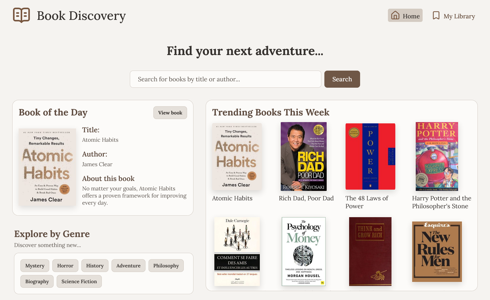
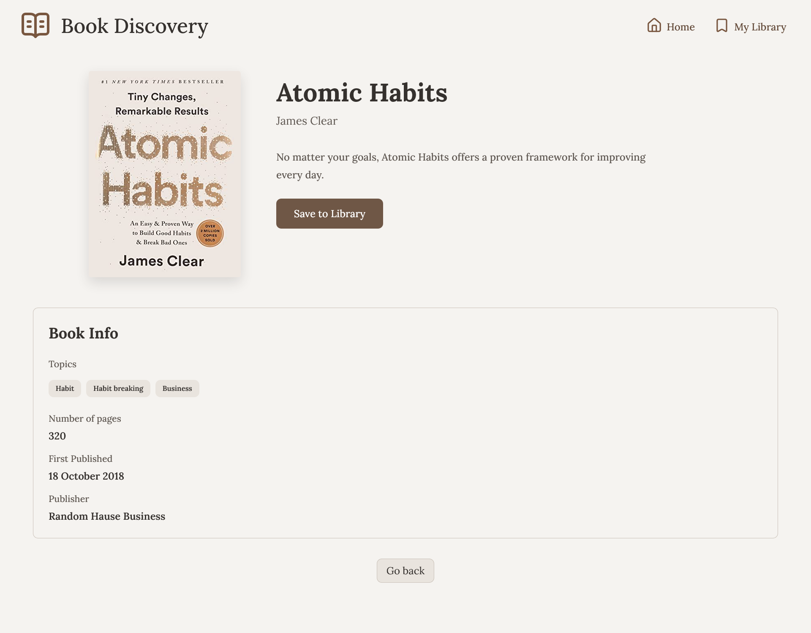
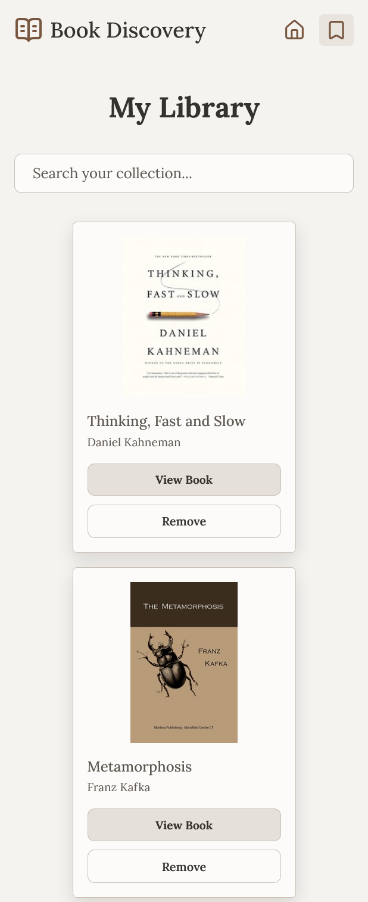
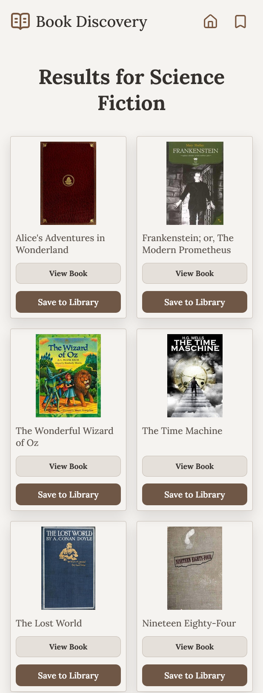

# Book Discovery

Book Discovery is a responsive website built with vanilla JavaScript, with book data fetched from the [Open Library API](https://openlibrary.org/developers/api). Users can explore current trending books, discover books across different genres, view detailed book information and build their own personal library by saving books that interest them.

## Preview

### Desktop

<p align="center">
  
  
</p>

### Mobile

<p align="center">
  
  
</p>

**[Live Demo:]**(https://book-discovery-six.vercel.app)

**[GitHub Repository:]**(https://github.com/RidaAli110/Book-Discovery.git)

## About The Project

[Explain what your project does, why you built it and what inspired the idea.]

## Features

- Book Discovery Dashboard – Explore trending books, discover genres and view the Book of the Day.
- Book Search – Search for books by title or author.
- Trending Books – Browse a collection of currently trending books.
- Explore by Genre – Discover books across different genres, including Mystery, Horror, History and Science Fiction.
- Book Details – View book descriptions, authors, topics, page counts, publication dates and publishers.
- My Library – Save books to a personal library and filter your saved books by title.
- Persistent Storage – Saved books are stored using Local Storage, so they remain available after refreshing the page.
- Responsive Design - built using a mobile-first approach to adapt to different screen sizes.
- Accessibility – Semantic HTML, accessible labels and keyboard-friendly interactive elements.
- API Integration – Fetch book information and cover images from the Open Library API.

## Technologies Used

- HTML5
- CSS3
- JavaScript
- [Open Library API](https://openlibrary.org/developers/api)

## Getting Started

Follow these instructions to run the project locally.

### Prerequisites

- A modern web browser (Chrome, Firefox, Edge, etc.).
- Visual Studio Code (or another code editor).
- Live Server extension for VS Code.
- An internet connection to access the Open Library API.

### Installation

1. Clone the repository:

   ```bash
   git clone https://github.com/RidaAli110/Book-Discovery.git
   ```

2. Navigate into the project folder:

   ```bash
   cd Book-Discovery
   ```

3. Open the project in your preferred code editor.
 ```bash
   code .
   ```
4. Start the development server.

